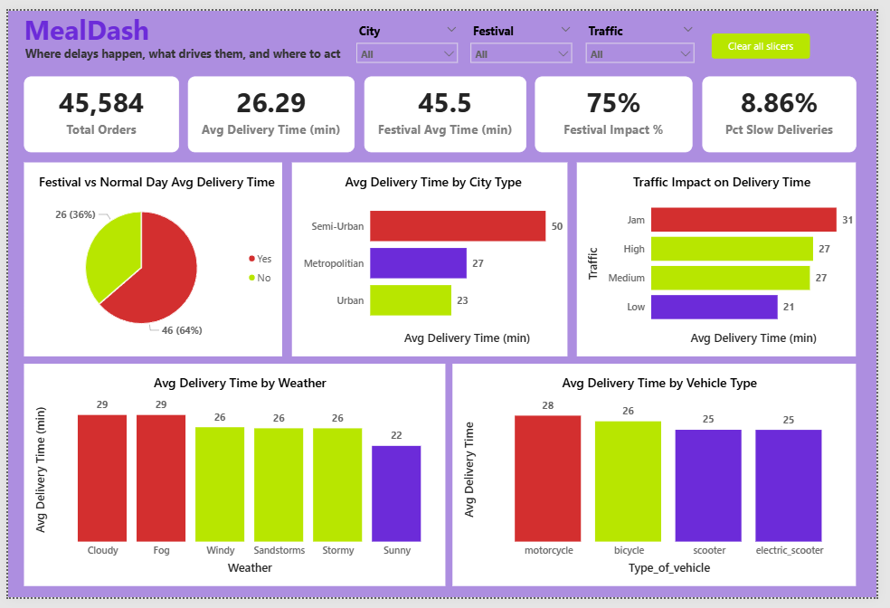
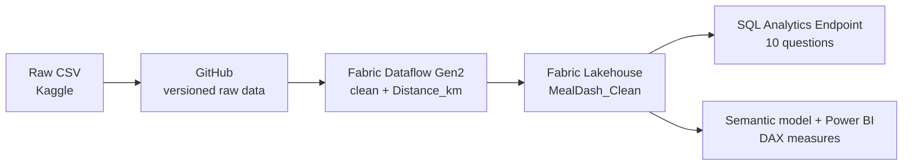
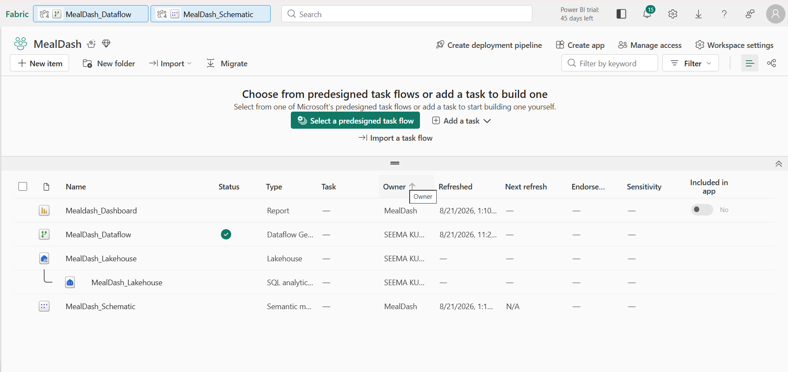
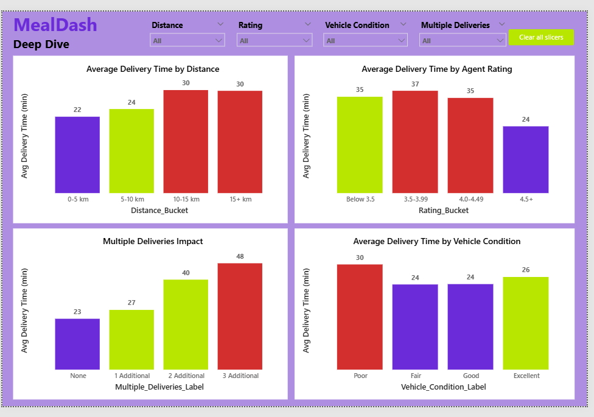
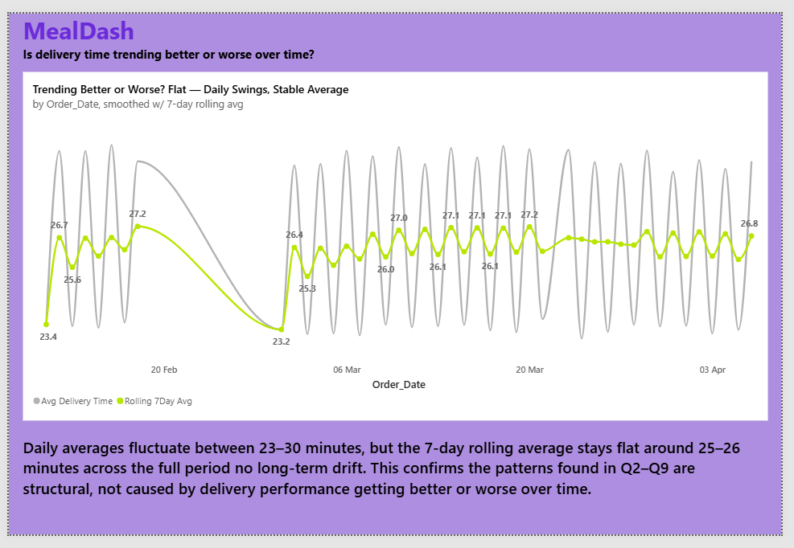

# 🍔 MealDash: Delivery Operations Analytics

**Why do some deliveries take 10 minutes and others almost an hour? This project finds out, and tells ops what to do about it.**

End-to-end analytics on 45,584 quick-commerce orders: Fabric Dataflow Gen2 → Lakehouse → SQL → Power BI → three recommendations ops can act on this week.

🔗 [**Live Dashboard**](https://app.fabric.microsoft.com/links/SJ5wVO19En?ctid=e93d71d6-b5c0-4b78-a861-d9964ecdfcd6&pbi_source=linkShare&bookmarkGuid=c964f109-a243-4282-9765-edfe9330625c) (Microsoft sign-in required) · 🖼️ [Static PDF of dashboard](Dashboard/Mealdash_Dashboard.pdf) · 📽️ [Presentation](Docs/MealDash_Presentation.pdf) · 📄 [Business Requirements](Docs/MealDash_BRD.pdf) · 🧾 [SQL Findings Report](Docs/SQL_Report.pdf) · 📐 [DAX Reference](Docs/MealDash_DAX_Measures.pdf)



---

## TL;DR (60 seconds)

**Problem:** Delivery time ranges from 10 to 54 minutes. Finding out why a week was slow took an analyst 1 to 2 days of digging. Ops had no quick answer.

**What I built:** A repeatable pipeline and a 3-page dashboard that answers "why was it slow?" in minutes.

**What I found:**
- 🎉 **Festival days are about 75% slower** (45.5 min vs about 26 min). Dates are known in advance.
- 📦 **Every extra bundled order adds time**, and it accelerates: 23 → 27 → 40 → 48 min.
- ⭐ **Agents rated 4.5+ deliver in 24 min.** Every lower rating bucket sits at 35 to 37 min.

**What ops should do:** Pre-plan festival staffing, cap bundling at 1 extra order for time-sensitive deliveries, and route urgent orders to top-rated agents.

---

## At a Glance

| Total orders | Avg delivery time | Festival avg time | Festival impact | Slow-delivery rate |
|:---:|:---:|:---:|:---:|:---:|
| **45,584** | **26.29 min** | **45.5 min** | **75%** | **8.86%** |

## What the Data Says

All numbers below match the dashboard. Each question was answered in SQL first: [full reasoning here](Docs/SQL_Report.pdf).

| # | Question | Finding (avg delivery time) |
|---|---|---|
| 1 | Overall | **26.3 min**, range 10 to 54 min |
| 2 | City type | Semi-Urban 50, Metropolitan 27, Urban 23. Metropolitan holds 34,000+ orders, Semi-Urban only 164 |
| 3 | Traffic | Jam 31, High 27, Medium 27, **Low 21**. Jam adds about 10 min |
| 4 | Weather | Cloudy 29, Fog 29, Windy 26, Sandstorms 26, Stormy 26, Sunny 22. **Storms are not the worst** |
| 5 | Distance | 0-5 km 22, 5-10 km 24, 10-15 km 30, 15+ km 30. The big jump is leaving the 5 km zone, then it plateaus |
| 6 | Vehicle type | Motorcycle 28, bicycle 26, scooter 25, electric scooter 25. Small effect |
| 7 | Agent rating | **4.5+ → 24 min.** Below 3.5 → 35, 3.5-3.99 → 37, 4.0-4.49 → 35 |
| 8 | Multiple deliveries | **None 23, 1 extra 27, 2 extra 40, 3 extra 48** |
| 9 | Festival | **45.5 min vs about 26 min on normal days (+75%)**, only 896 orders |
| 10 | Trend | 7-day rolling average stays flat (about 25 to 27 min), so these patterns are structural, not a drift |

## Recommendations

1. **Pre-plan festival-day staffing.** Festival orders average 45.5 min vs about 26 on normal days. At 896 orders the excess is roughly 17,500 delivery minutes. Festival dates are known in advance, so staffing can be targeted instead of company-wide.
2. **Limit bundling to 1 extra order for time-sensitive deliveries.** One extra order costs about 4 min. The second adds 13 more. Cost accelerates, so 1 is where it is still cheap.
3. **Prioritize 4.5+ rated agents for time-sensitive orders.** 24 min vs 35 to 37 min for every lower bucket. This is an association, not proven cause, so test it on a subset before changing routing for everyone.

Traffic and weather matter too, but ops cannot control them directly. These three are levers ops can pull.

## How I Kept the Numbers Honest

- **Sample size next to every average.** Semi-Urban looks like the worst city at 50 min, but it has only 164 orders out of 45,000+. I did not lead with it. Metropolitan (27 min, 34,000+ orders) matters far more in absolute terms.
- **Correlation, not causation.** Faster agents may simply get easier orders. Festival days may differ in other ways. Findings are labeled as associations.
- **No fake SLA.** The dataset has no promised delivery time, so "slow delivery" (8.86%) is benchmarked against segment averages, not a formal target.
- **Rolling average for trends.** Daily averages swing between 23 and 30 min, which looks alarming. A 7-day rolling average shows the real trend is flat.
- **Surprises flagged, not oversold.** Fog and Cloudy beating Storms was unexpected. I marked it for follow-up instead of calling it fact.

## Pipeline



SQL and Power BI read the **same** Lakehouse table, `MealDash_Clean`, so numbers match everywhere.



| Tool | Why I used it |
|---|---|
| **GitHub** | Versions the raw CSV and acts as a refreshable source, not a one-off upload |
| **Fabric Dataflow Gen2** (Power Query) | All cleaning in one repeatable step: nulls, formats, category standardization, Haversine `Distance_km`. A refresh re-runs everything |
| **Fabric Lakehouse** | One governed home for the cleaned table |
| **SQL** (SQL Analytics Endpoint) | The 10 business questions: aggregation, CASE bucketing, window function for the 7-day rolling average |
| **Power BI + DAX** | Lets non-technical stakeholders explore findings with slicers, no query reading needed |
| **Excel** | Light exploratory pivots and charts only ([`Excel_Analysis/`](Excel_Analysis/)). Not used for cleaning |

## Dataset

| Item | Detail |
|---|---|
| Source | [Zomato Delivery Operations Analytics Dataset, Kaggle](https://www.kaggle.com/datasets/saurabhbadole/zomato-delivery-operations-analytics-dataset) |
| Records | 45,584 orders |
| Fields | Timestamps, GPS coordinates, weather, traffic density, agent ratings, vehicle type and condition, multiple deliveries flag, festival flag, city type |
| Scope | In: traffic, weather, distance, vehicle, agent performance, bundling, festivals. Out on purpose: pricing, menus, app experience |

## Data Cleaning (all in Dataflow Gen2)

- Connected Dataflow Gen2 to the raw CSV hosted on GitHub.
- Handled nulls and inconsistent formats.
- Standardized categorical fields (city type, weather, traffic density).
- Calculated straight-line distance `Distance_km` from GPS coordinates with the Haversine formula.
- Loaded the result into Lakehouse table `MealDash_Clean`.

## Dashboard

**Page 1, Executive Overview.** KPI cards plus festival, city, traffic, weather and vehicle breakdowns. Slicers for City, Festival, Traffic.


**Page 2, Delivery Drivers Deep Dive.** Distance, agent rating, vehicle condition and multiple deliveries, each slicer-driven.



**Page 3, Trend Over Time.** Daily averages with a 7-day rolling average to separate noise from signal.



## Code Samples

<details>
<summary><b>SQL: agent rating impact (CASE bucketing)</b></summary>

```sql
--Do higher-rated delivery agents deliver faster?
SELECT 
    CASE 
        WHEN Delivery_person_Ratings >= 4.5 THEN '4.5+'
        WHEN Delivery_person_Ratings >= 4.0 THEN '4.0-4.49'
        WHEN Delivery_person_Ratings >= 3.5 THEN '3.5-3.99'
        ELSE 'Below 3.5'
    END AS Rating_Bucket,
    AVG([Time_taken _min_]) AS Avg_Delivery_Time,
    COUNT(*) AS Total_Orders
FROM MealDash_Clean
WHERE Delivery_person_Ratings IS NOT NULL
GROUP BY 
    CASE 
        WHEN Delivery_person_Ratings >= 4.5 THEN '4.5+'
        WHEN Delivery_person_Ratings >= 4.0 THEN '4.0-4.49'
        WHEN Delivery_person_Ratings >= 3.5 THEN '3.5-3.99'
        ELSE 'Below 3.5'
    END
ORDER BY Rating_Bucket DESC;
```
</details>

<details>
<summary><b>SQL: 7-day rolling average (window function)</b></summary>

```sql
--Is delivery time trending better or worse over time?
SELECT 
    Order_Date,
    AVG([Time_taken _min_]) AS Daily_Avg_Delivery_Time,
    AVG(AVG([Time_taken _min_])) OVER (
        ORDER BY Order_Date 
        ROWS BETWEEN 6 PRECEDING AND CURRENT ROW
    ) AS Rolling_7Day_Avg
FROM MealDash_Clean
GROUP BY Order_Date
ORDER BY Order_Date;
```
</details>

<details>
<summary><b>DAX: festival impact and rolling average</b></summary>

```dax
Festival Avg Time =
CALCULATE(
    AVERAGE(MealDash_Clean[Time_taken _min_]),
    MealDash_Clean[Festival] = "Yes"
)

Normal Day Avg Time =
CALCULATE(
    AVERAGE(MealDash_Clean[Time_taken _min_]),
    MealDash_Clean[Festival] = "No"
)

Festival Impact % =
DIVIDE([Festival Avg Time] - [Normal Day Avg Time], [Normal Day Avg Time])

Rolling 7Day Avg =
AVERAGEX(
    DATESINPERIOD(MealDash_Clean[Order_Date], MAX(MealDash_Clean[Order_Date]), -7, DAY),
    CALCULATE(AVERAGE(MealDash_Clean[Time_taken _min_]))
)
```

Full list: [`Docs/MealDash_DAX_Measures.pdf`](Docs/MealDash_DAX_Measures.pdf)
</details>

## Project Structure

```
MealDash/
├── Dashboard/        Power BI file (.pbix, .pbit) and PDF export
├── Data/             Raw/Raw_Data.csv and Clean/MealDash_Clean.csv
├── Docs/             BRD, presentation, SQL findings report, DAX reference
├── Excel_Analysis/   Exploratory pivots and charts
├── SQL/              Q1 to Q10, one file per business question
├── Screenshots/      Dashboard and Fabric screenshots
├── LICENSE
└── README.md
```

## How to Run

1. Clone: `git clone https://github.com/seema-kri/MealDash.git`
2. Look at the raw CSV in [`Data/Raw/`](Data/Raw/) and the cleaned output in [`Data/Clean/`](Data/Clean/).
3. In a Fabric workspace, create a Lakehouse and a Dataflow Gen2. Point the dataflow at the raw CSV on GitHub (the `raw.githubusercontent.com` URL of `Data/Raw/Raw_Data.csv`), apply the cleaning steps above, and load to table `MealDash_Clean`.
4. Run the queries in [`SQL/`](SQL/) on the Lakehouse SQL Analytics Endpoint (T-SQL).
5. Open `Dashboard/Mealdash_Dashboard.pbix` in Power BI Desktop, or use the live link.

## Limitations and Next Steps

- Validate the festival effect against a full year of festival dates (current data covers one window, 896 festival orders).
- Replace straight-line (Haversine) distance with road-route distance.
- Test whether agent rating causes faster delivery or only correlates with it.
- Add a live data connection for ongoing monitoring (this is a historical, diagnostic project).
- Add a cost per delivery minute to rank fixes by money.

## Author

**Seema Kumari**, Data Analyst

📧 [seemakri136@gmail.com](mailto:seemakri136@gmail.com) · 🔗 [LinkedIn](https://linkedin.com/in/seema-kumari-375763308)

Open to data analyst roles, collaborations and conversations around analytics.

⭐ If this project helped you, a star on GitHub is appreciated.
